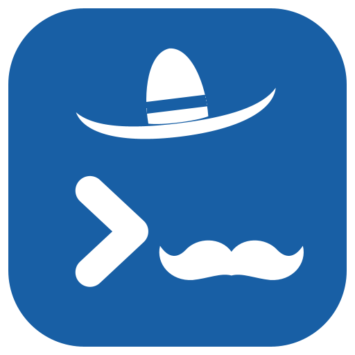
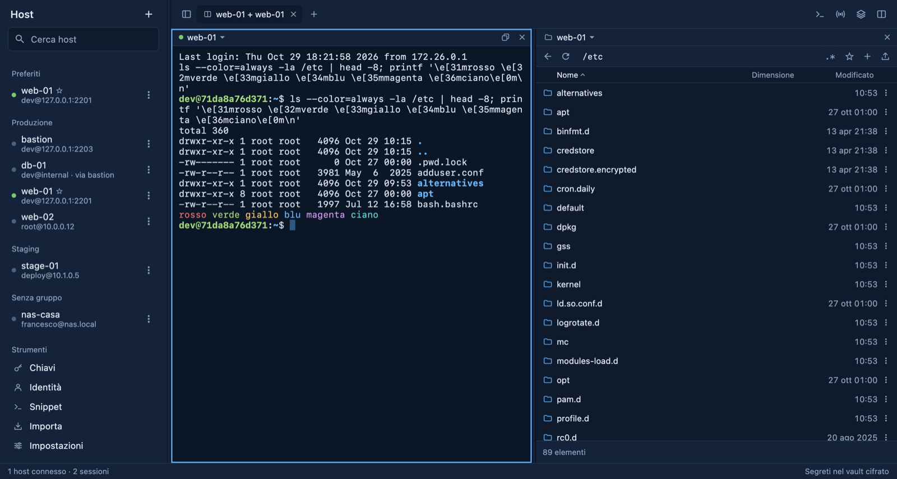

<p align="center">
  
</p>

# El Termino

Un client SSH e SFTP per chi passa la giornata su tante macchine. Terminali, file e API dei server stanno nella stessa finestra, in schede che si dividono e si raggruppano come serve. Gira su macOS, Windows, Linux e Android, è scritto in Kotlin Multiplatform con Compose e l'interfaccia, in stile «Carta», usa solo componenti propri.



## Cosa fa

- **Terminali.** Più sessioni per host sulla stessa connessione, in schede che si dividono in due o quattro riquadri e si raccolgono in gruppi con nome e colore. Se la rete cade, la sessione si ricollega nello stesso terminale. Il broadcast scrive in più terminali insieme, gli snippet con variabili `{{nome}}` lanciano i comandi di tutti i giorni. Il testo si seleziona trascinando e si copia al rilascio; il clic destro offre Copia e Incolla.
- **File.** Pannelli locali e remoti affiancati e una sola coda di trasferimenti, anche da un server all'altro, in streaming e senza file temporanei, con pausa, ripresa e scelta sui conflitti. I file si trascinano dal Finder o da Esplora risorse, anche sopra un terminale, e si modificano sul server con un editor che salva in modo atomico.
- **Richieste HTTP.** Come Postman, ma dentro la connessione SSH: le API in ascolto solo sul server si provano senza aprire porte. Collezioni con variabili per host, verifiche senza scrivere codice, esecuzione su un gruppo di host con l'esito di ognuno, import da Postman e da curl.
- **Accesso.** Password, chiavi Ed25519, RSA ed ECDSA (anche PuTTY), OTP e jump host, con la host key sempre verificata. Password e chiavi stanno in un vault cifrato con AES-256-GCM, la cui chiave è nel portachiavi del sistema.
- **Import.** Da Termius installato sullo stesso computer, credenziali comprese, da un CSV o da `~/.ssh/config`.
- **A modo tuo.** Sei temi per app e terminale (Carta, Notte, Nord, Solarized chiaro, Dracula, Tokyo Night), due icone (El Bigote e Píxel), spazi di lavoro salvati che si riaprono con un clic, una barra laterale che si richiude.
- **Tastiera.** Le scorciatoie di un'app del Mac: ⌘T per una nuova scheda, ⌘W per chiuderla, ⌥⌘← e ⌥⌘→ per passare dall'una all'altra, ⌘1…⌘9, ⌃⌘S per la barra laterale, tutte anche nei menu. Nel terminale ⌘⌫ cancella la riga e ⌥← ⌥→ si spostano di una parola, come in iTerm2. Su Windows e Linux sono le stesse con Ctrl+Maiuscole.
- **Aggiornamenti.** L'app installata trova le nuove versioni pubblicate su GitHub e si aggiorna da sola.

## Installare

Sul Mac con Apple Silicon: scarica il DMG dalle [Release](https://github.com/Woosheet/El-Termino/releases), aprilo e trascina El Termino in Applicazioni. L'app non è firmata con un Developer ID di Apple, quindi la prima volta va aperta da Impostazioni di Sistema → Privacy e sicurezza → «Apri comunque». Da lì in poi gli aggiornamenti arrivano dall'app.

Su Windows, Linux e Android per ora si compila dal sorgente, come spiegato sotto.

## A che punto è

Le fasi da 0 a 8 del [piano](docs/PLAN.md) sono fatte: terminali, file, schede e gruppi, richieste HTTP, primo avvio con Termius, temi e avvisi, autenticazione avanzata (agent, certificati host, biometria, backup cifrato), port forwarding, monitor delle risorse, Docker e registrazione delle sessioni. Resta Mosh. Le scelte tecniche sono in [docs/decisions/](docs/decisions/).

## Sviluppo

### Requisiti

- JDK 21
- Android SDK con la piattaforma 37 (percorso in `local.properties`, `sdk.dir=…`)
- Docker, per i server di test

### Comandi

```bash
./gradlew :app-desktop:run                 # app desktop
./gradlew :app-android:installDebug        # app Android su emulatore o dispositivo
```

I dati del desktop stanno in `~/Library/Application Support/El Termino` (macOS), `%APPDATA%\El Termino` (Windows) o `~/.local/share/el-termino` (Linux). Si possono spostare con `-Deltermino.dataDir=…`. La chiave del vault va nel portachiavi di sistema.

### Pacchetti desktop

Il DMG va creato con un JDK 21 che non sia quello di Homebrew: quello si porta dietro librerie di `/opt/homebrew` che sugli altri Mac mancano. Per esempio con Amazon Corretto:

```bash
JAVA_HOME=~/Library/Java/JavaVirtualMachines/corretto-21.0.13/Contents/Home ./gradlew :app-desktop:packageShareableDmg
```

Il file esce in `app-desktop/build/dmg/`, con l'app accanto al collegamento ad Applicazioni in cui trascinarla. Lo monta `app-desktop/packaging/make-dmg.sh` con `hdiutil`: il DMG di `packageDmg` dispone il contenuto pilotando il Finder e, senza quel permesso, esce senza il collegamento. Funziona sui Mac con Apple Silicon e non è firmato con un Developer ID, quindi chi lo scarica deve aprirlo la prima volta da Impostazioni di Sistema → Privacy e sicurezza → «Apri comunque». MSI e DEB si creano allo stesso modo su Windows e Linux (`packageMsi`, `packageDeb`). L'icona si rigenera da `app-desktop/packaging/` con `java MakeIcons.java` e poi `iconutil -c icns icon.iconset`.

### Versioni e aggiornamenti

Una nuova versione si pubblica con un tag:

```bash
git tag v1.0.1 && git push origin v1.0.1
```

Il workflow [release.yml](.github/workflows/release.yml) crea il DMG con quella versione su un Mac Apple Silicon di GitHub e lo pubblica come Release, con il nome `El-Termino-<versione>-macos-arm64.dmg`. L'app installata cerca l'ultima Release all'avvio (si spegne nelle Impostazioni) e la propone nella barra in basso. Con «Aggiorna e riavvia» la scarica, controlla che dentro ci sia El Termino nella versione annunciata e con una firma valida, la mette accanto a quella in uso e la sostituisce appena l'app si chiude, poi la riapre. Una build lanciata da Gradle non ha versione e non cerca aggiornamenti.

In locale il DMG prende la versione da `-PappVersion=1.2.3` (di base 1.0.0). Per provare un aggiornamento senza GitHub, si lancia l'app con `-Deltermino.releasesUrl=file:///…/latest.json`, un file con la stessa forma della risposta di GitHub.

### Test

Molti test girano contro i server OpenSSH di `testenv/`:

```bash
./testenv/gen-keys.sh
docker compose -f testenv/docker-compose.yml up -d --build
./gradlew :core:ssh:desktopTest :core:terminal:desktopTest :core:importer:desktopTest :core:data:desktopTest :core:vault:desktopTest :shared:desktopTest
./gradlew :app-android:connectedDebugAndroidTest   # con un emulatore acceso
```

- `:shared:desktopTest` prova il flusso di connessione completo e salva gli snapshot dell'interfaccia in `shared/build/snapshots/`. Copre host key, password, OTP, chiavi, jump host e import, ma anche connessioni condivise, riconnessione dopo una caduta di rete simulata, broadcast e snippet.
- `TransferFlowTest` copia file e cartelle tra basic, bastion, internal e una cartella locale in una sola coda. Prova anche pausa e ripresa, i conflitti, una caduta di rete a metà, l'editor remoto e le operazioni del pannello file.
- `TabLayoutFlowTest` salva una disposizione con gruppi e una scheda divisa, ricrea l'app sugli stessi file e la riapre.
- `SessionSoakTest` tiene 10 sessioni occupate per 20 secondi. Per la prova lunga della Fase 2:

  ```bash
  ./gradlew :shared:desktopTest --tests '*SessionSoakTest*' -PsoakSeconds=14400
  ```
- `spikes/` contiene le prove della Fase 0 (`./gradlew :spikes:mina:test` e simili).
